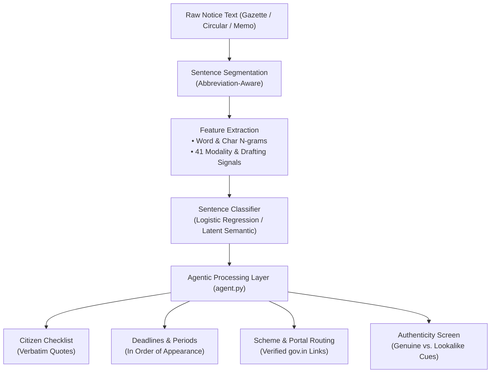

# 📜 SuchnaSaar (सूचना सार)
### *AI-Powered Citizen Decision Support for Indian Government Notices*

<div align="center">

[](https://www.python.org/)
[](https://flask.palletsprojects.com/)
[](https://scikit-learn.org/)
[](file:///c:/Users/Harish/Desktop/SuchnaSaar_Project/SuchnaSaar_source_code/app.py)
[](file:///c:/Users/Harish/Desktop/SuchnaSaar_Project/SuchnaSaar_source_code/smoke_test.py)

**Read a government circular, gazette, or public notice in plain language.**  
*Instantly identify what is background, what is required of you, and when it is due — with official portal routing and authenticity screening.*

[Key Features](#-key-features) • [How It Works](#-how-it-works) • [Quickstart](#-quickstart) • [Evaluation & Benchmarks](#-evaluation--benchmarks) • [API Reference](#-api-reference)

---

</div>

## 📌 Problem & Vision

Indian public notices, circulars, and gazette notifications are written in dense administrative and legal register. Critical citizen actions (linking documents, filing returns, submitting certificates) and strict cut-off dates are frequently buried inside multi-page preambles. Furthermore, citizens are increasingly exposed to fraudulent lookalike notices on social media.

**SuchnaSaar** provides instant decision support:
1. **Separates legal boilerplate from citizen obligations.**
2. **Never paraphrases requirements** — quotes actionable directives verbatim.
3. **Extracts all deadlines & timelines** in chronological order.
4. **Routes citizens to verified government portals and helplines.**
5. **Screens documents against real-world fake notice cues.**

> [!NOTE]
> **Decision support, not legal advice.** SuchnaSaar extracts, classifies, and verifies what is written. It does not interpret law and cannot guarantee legal validity.

---

## ⚡ Key Features

| Feature | Description |
| :--- | :--- |
| 🔍 **Sentence-Level Triage** | Categorizes every sentence into **Reference** (background/preamble), **Action Required** (citizen ask), or **Deadline** (cut-off date/time). |
| 📋 **Verbatim Checklist** | Generates a clean, numbered citizen checklist quoting exact clauses so no detail is hallucinated or lost. |
| ⏳ **Timeline & Period Extraction** | Automatically identifies specific dates (e.g., *12th October, 2026*), relative windows (*within 30 days*), and submission hours. |
| 🏛️ **Official Portal Routing** | Identifies the government scheme (e.g., PM-KISAN, EPF, IT e-Filing) and links to verified official `.gov.in` / `.nic.in` domains and national helplines. |
| 🛡️ **Authenticity Screener** | Checks for official markers (file numbers, gazette references, ministry seals) vs. common scam cues (UPI payment demands, suspicious shortlinks, OTP requests). |
| 🔒 **100% In-Memory Privacy** | Completely offline execution. No database, no file logging, no external API calls, and zero telemetry. |

---

## 🧠 How It Works

SuchnaSaar pairs a statistical machine learning classifier with an explainable rule-based agent layer:



### 1. 41 Engineered Modality Signals (`features.py`)
Legal and administrative sentences cannot be scored on vocabulary alone. Words like *"shall"* and *"within"* appear in both preambles and mandatory orders. SuchnaSaar computes **41 interpretable signals**, including:
- **Directive Modality:** `shall`, `must`, `is required to`, `are directed to`.
- **Concrete Asks:** Document submission, fee payment, e-KYC/linking, renewals, inspections.
- **Negative Obligations:** `no person shall`, `prohibited`.
- **Administrative Boilerplate:** `in exercise of powers`, `hereby notified`, `w.e.f.`, `supersession of`.
- **Structural Signals:** Numbered lists, heading characteristics, date counts, and government domain mentions.

### 2. The Agent Layer (`agent.py`)
Rather than relying on an opaque generative model that might hallucinate portal URLs or phone numbers, the agent layer uses explicit, auditable routing rules mapped against verified official registries in `data.py`.

---

## 🚀 Quickstart

### Prerequisites
- Python 3.10 or higher
- `pip` package manager

### 1. Clone the repository
```bash
git clone https://github.com/parmarkrishna05145-cell/SuchnaSaar.git
cd SuchnaSaar
```

### 2. Set up virtual environment
```bash
# Windows PowerShell
python -m venv .venv
.venv\Scripts\Activate.ps1

# Linux / macOS
python3 -m venv .venv
source .venv/bin/activate
```

### 3. Install dependencies
```bash
pip install -r requirements.txt
```

### 4. Run the web application
```bash
python app.py
```
Open **[http://127.0.0.1:5000](http://127.0.0.1:5000)** in your browser.

---

## 📊 Evaluation & Benchmarks

The model is evaluated using a rigorous three-tier evaluation script (`train.py`):
1. **5-Fold Stratified Cross-Validation:** Overall corpus performance.
2. **Stratified Held-Out Corpus Probe:** Unseen slice of the standard corpus.
3. **Hard Out-of-Sample Probe:** Deliberately ambiguous, complex sentences with subtle or nested conditions.

| Model Candidate | Architecture | 5-Fold CV Accuracy | 5-Fold Macro F1 | Hard Probe Accuracy | Hard Probe Macro F1 |
| :--- | :--- | :---: | :---: | :---: | :---: |
| **Baseline** | TF-IDF (word + char) + Logistic Regression | 91.8% | 0.918 | 72.0% | 0.697 |
| **Hybrid** | TF-IDF + 41 Engineered Modality Signals | **94.2%** | **0.943** | 76.0% | 0.749 |
| **Latent (Selected)** | Char TF-IDF + TruncatedSVD(120) + Logistic Regression | 91.3% | 0.914 | **80.0%** | **0.793** |
| **Ensemble** | 0.6 × Hybrid + 0.4 × Latent | 93.7% | 0.938 | 76.0% | 0.749 |

> **Why Latent was chosen:** While the Hybrid model scores slightly higher on cross-validation, the **Latent Semantic model** achieves the highest generalization on the **Hard Out-of-Sample Probe (80.0% accuracy, 0.793 Macro-F1)**.

To reproduce training and benchmarks:
```bash
python train.py     # Generates model.joblib and metrics.json
python smoke_test.py # Executes comprehensive end-to-end test suite
```

---

## 📡 API Reference

### `POST /analyze`
Analyzes a submitted notice text.

#### Request
```bash
curl -X POST http://127.0.0.1:5000/analyze \
  -H "Content-Type: application/json" \
  -d '{
    "text": "Beneficiaries are directed to link their bank account with the Aadhaar number. The last date for the linking of the Aadhaar number with the bank account is 30 April. This is for information of all concerned."
  }'
```

#### Response (`200 OK`)
```json
{
  "verdict": "This notice asks you to do 1 thing and sets 1 deadline.",
  "role_counts": {
    "action_required": 1,
    "deadline": 1,
    "reference": 1
  },
  "actions": [
    {
      "n": 1,
      "sentence": "Beneficiaries are directed to link their bank account with the Aadhaar number.",
      "confidence": 0.884
    }
  ],
  "deadlines": [
    {
      "phrase": "30 April."
    }
  ],
  "scheme": {
    "name": "Aadhaar Services",
    "portal": "https://uidai.gov.in/",
    "source": "uidai.gov.in"
  },
  "routes": [
    {
      "name": "UIDAI / My Aadhaar",
      "url": "https://uidai.gov.in/",
      "why": "matches the subject of this notice"
    }
  ],
  "safety": {
    "level": "consistent",
    "headline": "This notice shows the cues of a genuine official document. That is not a guarantee.",
    "genuine_cues": ["Uses standard official notification phrasing"],
    "caution_cues": []
  },
  "sentence_count": 3
}
```

### Additional Endpoints
- `GET /health`: Model status, signal counts, and security verification.
- `GET /sample/<notice_id>`: Returns one of the 5 bundled sample notices (`N1` to `N5`).

---

## 📁 Project Structure

```text
SuchnaSaar/
├── app.py                # Flask web server and REST API endpoints
├── agent.py              # Sentence segmentation, checklist generation, routing, safety screen
├── features.py           # 41 engineered notice modality and drafting signals
├── models.py             # Model definitions (Baseline, Hybrid, Latent, Ensemble)
├── train.py              # Training pipeline, stratified evaluation, and export
├── dataset.py            # Dataset split handling and hard out-of-sample probe
├── data.py               # Drafting corpus, bundled notices, verified portals & helplines
├── smoke_test.py         # End-to-end integration and API test suite
├── model.joblib          # Persisted, lightweight production model (~6.2 MB)
├── metrics.json          # Complete benchmark results and signal importance rankings
├── requirements.txt      # Production runtime dependencies
├── templates/
│   └── index.html        # Modern, dark-mode single-page interface
└── README.md             # Project documentation
```

---

## 🛡️ Privacy & Security Principles

- **Zero Data Retention:** Submitted notice texts are parsed exclusively in RAM. Nothing is written to databases, temporary files, or server logs.
- **No Outbound Calls:** Operates 100% offline. Zero tracking pixels, telemetry, or external third-party API dependencies.
- **Verified Registry Only:** Helplines and official websites are strictly matched against known `.gov.in` and `.nic.in` domains hardcoded in `data.py`.

---

## 🤝 Contributing

Contributions are welcome! If you have encountered a real, confusing public notice or circular:
1. Redact any personal identifiable information (names, personal phone numbers, addresses).
2. Open an issue or pull request adding the sentence style to `data.py`.

---

## ⚖️ Disclaimer

SuchnaSaar is a civic technology tool created for public assistance. It does not provide legal advice, does not interpret statutory regulations, and cannot authenticate notices with legal finality. Citizens are encouraged to verify important documents against the [eGazette of India](https://egazette.gov.in/) or the issuing department's official website.
